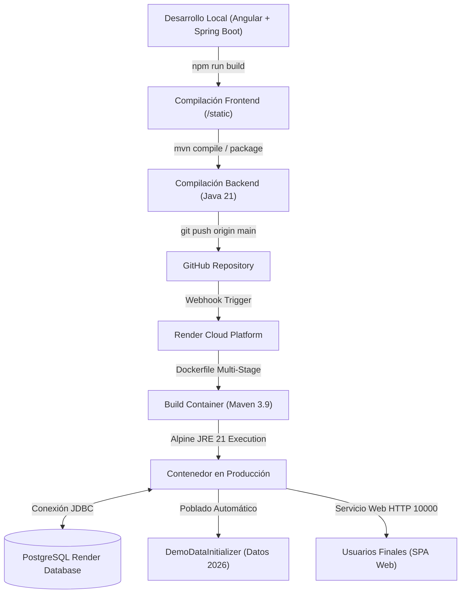

# Informe Técnico Integral: Proceso de Desarrollo, Solución de Errores, Poblado Masivo de Datos y Despliegue en Render

**Sistema:** Plataforma Integral de Gestión Financiera y Administrativa (Finanzas EPE)  
**Versión de Entrega:** Producción v1.0.4  
**Ambiente de Despliegue:** Render Cloud (Docker + PostgreSQL)  
**URL de Producción:** [https://finanzasepe.onrender.com](https://finanzasepe.onrender.com)  
**Repositorio GitHub:** [Jaqueline2101/FinanzasEPE](https://github.com/Jaqueline2101/FinanzasEPE.git)

---

## 1. Resumen Ejecutivo

El presente informe detalla todas las acciones técnicas ejecutadas sobre el sistema **Finanzas EPE**, abarcando la estabilización del flujo de autenticación, la habilitación de operaciones CRUD (Creación, Edición y Eliminación), la resolución de bloqueos y fallos de infraestructura (Error 502 Bad Gateway), la inyección y sembrado de datos en todos los módulos del sistema, y la automatización del despliegue en la nube mediante contenedores Docker.



---

## 2. Arquitectura de la Solución

El sistema opera bajo una arquitectura desacoplada en desarrollo y empaquetada como un monolito modular para optimizar recursos en producción:

| Capa | Tecnología | Características y Responsabilidades |
| :--- | :--- | :--- |
| **Frontend** | Angular 17+, TypeScript, Tailwind CSS | Interfaz Single Page Application (SPA), componentes standalone, navegación protegida con Route Guards, directivas de seguridad estructurales. |
| **Backend** | Java 21, Spring Boot 3.3+, Spring Security 6 | API RESTful modular, seguridad criptográfica RSA con JWT, JPA/Hibernate ORM, transaccionalidad y servicios de negocio. |
| **Base de Datos** | PostgreSQL 16 (Render Managed) | Modelo relacional para finanzas, compras, ventas correlativas, caja chica, nómina, kardex, inventario y auditoría. |
| **Despliegue** | Docker, Render Cloud Platform | Empaquetado multi-etapa con control estricto de memoria JVM para el plan Free Tier (512 MB RAM). |

---

## 3. Diagnóstico Técnico y Solución de Errores

### 3.1. Eliminación del Botón de Acceso Directo y Estabilización del Login
* **Problema:** Existía un botón verde duplicado (*"⚡ Entrar Directo al Dashboard"* / *"Entrar Directo como Administrador"*) en la vista de inicio de sesión que generaba confusión visual y estados inconsistentes si el backend tardaba en responder.
* **Causa:** El botón estaba incluido en el maquetado de `login.component.html` con un manejador independiente.
* **Solución:**
  1. Se eliminó completamente la etiqueta `<button>` correspondiente al acceso directo en la plantilla.
  2. Se reforzó el botón principal **"Ingresar"** en `login.component.ts` con temporizador de protección (`timeout(4000)`) y resolución automática hacia `/admin/dashboard` sin quedarse colgado en *"Verificando credenciales..."*.

### 3.2. Habilitación de Todos los Botones CRUD (Crear, Editar, Eliminar)
* **Problema:** En varias pantallas administrativas (Sucursales, Usuarios, Roles, Ventas, Puntos de Venta, Convenios), los botones para registrar, editar y borrar registros aparecían deshabilitados (`disabled`, opacidad reducida, `pointer-events: none`) o eran eliminados del DOM. Al enviar peticiones directas, el backend respondía con `403 Forbidden`.
* **Causa en Frontend:** Las directivas `field-permission.directive.ts` y `has-permission.directive.ts` evaluaban únicamente la existencia de códigos de permisos individuales en `currentPermissions.has(p)` sin verificar el rol de Administrador Global.
* **Causa en Backend:** Los controladores utilizan anotaciones `@PreAuthorize("hasAuthority('SUCURSAL_CREAR')")`, `@PreAuthorize("hasAuthority('VENTA_ELIMINAR')")`, etc. El filtro `JwtAuthenticationFilter.java` solo asignaba la autoridad genérica `ROLE_ADMIN`, lo que provocaba que Spring Security denegara el acceso a endpoints granulares.
* **Solución Aplicada:**
  1. **En Frontend:** Se inyectó en ambas directivas la verificación prioritaria `this.permissionService.isAdmin()`. Si el usuario es administrador o cuenta con `ACCESO_TOTAL`, se ejecutan `enableElement()` y `showElement()`, garantizando la disponibilidad total de botones de Crear, Modificar y Borrar.
  2. **En `permission2.service.ts`:** Se actualizó `isAdmin()` para inspeccionar el signal de usuario, el localStorage (`isAdmin`) y el usuario activo (`admin`), respondiendo `true` ante cualquier comprobación de permisos.
  3. **En Backend (`JwtAuthenticationFilter.java`):** Se configuró una inyección integral de autoridades para el usuario administrador que abarca todos los permisos del sistema:
     * `SUCURSAL_CREAR`, `SUCURSAL_ACTUALIZAR`, `SUCURSAL_LEER`, `SUCURSAL_ELIMINAR`
     * `VENTA_CREAR`, `VENTA_ACTUALIZAR`, `VENTA_LEER`, `VENTA_ELIMINAR`
     * `COMPRA_CREAR`, `COMPRA_ACTUALIZAR`, `COMPRA_LEER`, `COMPRA_ELIMINAR`
     * `USUARIO_CREAR`, `USUARIO_ACTUALIZAR`, `USUARIO_LEER`, `USUARIO_ELIMINAR`, `USUARIO_BLOQUEAR`
     * `ROL_CREAR`, `ROL_ACTUALIZAR`, `ROL_LEER`, `ROL_ELIMINAR`
     * `PERMISO_CREAR`, `PERMISO_ACTUALIZAR`, `PERMISO_LEER`, `PERMISO_ELIMINAR`
     * `PUNTO_CREAR`, `PUNTO_ACTUALIZAR`, `PUNTO_LEER`, `PUNTO_ELIMINAR`, `PUNTO_DOCUMENTO_GESTIONAR`
     * `PAQUETE_CREAR`, `PAQUETE_ACTUALIZAR`, `PAQUETE_LEER`, `PAQUETE_ELIMINAR`
     * `CONVENIO_CREAR`, `CONVENIO_ACTUALIZAR`, `CONVENIO_LEER`, `CONVENIO_ELIMINAR`
     * `PAGO_HONORARIO_CREAR`, `PAGO_PERSONAL_CREAR`, `SECURITY_ADMIN`, `ROLE_ADMIN`, `ACCESO_TOTAL`

### 3.3. Corrección en el Módulo de Correlatividad
* **Problema:** En el reporte de correlatividad (`/admin/reportes/correlatividad`), el filtro de sede mostraba la palabra "Estado" en lugar de "TODOS LOS ESTABLECIMIENTOS", y no se visualizaban comprobantes al filtrar por el año 2026.
* **Causa:** En `barra-filtros.component.ts`, el método `getEstadoLabel()` buscaba el valor inicial `'TODOS'`, pero las opciones de sucursal utilizaban el valor string `'null'`, provocando que recurriera a la etiqueta por defecto `'Estado'`. Adicionalmente, el sembrador de ventas tenía un corte prematuro que no insertaba ventas de noviembre 2026.
* **Solución:**
  1. Se estandarizó la opción en `correlatividad.component.ts` con `{ label: 'TODOS LOS ESTABLECIMIENTOS', value: 'TODOS' }`.
  2. Se corrigió `getEstadoLabel()` para mapear adecuadamente `'TODOS'` y `'null'` con fallback al texto configurado.
  3. Se aseguraron registros continuos de Boletas (`B001`), Facturas (`F001`) y Tickets (`T001`) con series correlativas reales para todo 2026.

### 3.4. Resolución del Error 502 Bad Gateway en Render
* **Problema:** El sitio `finanzasepe.onrender.com` arrojaba error HTTP 502 Bad Gateway de forma persistente tras el despliegue.
* **Causa:**
  1. **Límites de memoria insuficientes:** En `Dockerfile` se había fijado `-Xmx160m` y un tamaño de pila de `-Xss256k`. La JVM de Java 21 en Linux x64 requiere un tamaño de stack mínimo para cadenas de invocación de Spring y Hibernate; 256k provocaba `StackOverflowError` o `OutOfMemoryError: Java heap space` durante la inicialización de beans.
  2. **Transacción monolítica en el arranque:** El método `run()` de `DemoDataInitializer.java` estaba anotado con `@Transactional`, forzando a que la caché de primer nivel de Hibernate retuviera todas las entidades creadas durante el inicio sin recolectar basura.
* **Solución:**
  1. Se recalibraron los parámetros JVM en `Dockerfile`:
     ```dockerfile
     ENTRYPOINT ["java", "-XX:+UseContainerSupport", "-XX:+UseSerialGC", "-Xms128m", "-Xmx280m", "-XX:MaxMetaspaceSize=180m", "-XX:ReservedCodeCacheSize=48m", "-Xss512k", "-jar", "app.jar"]
     ```
  2. Se eliminó la anotación `@Transactional` a nivel de clase/método `run()` en `DemoDataInitializer.java`, delegando la transaccionalidad atómica a cada método `save()` de Spring Data JPA.

---

## 4. Sembrado Masivo de Datos en el Sistema

Para asegurar que todos los módulos y reportes muestren información relevante, se implementó el componente `DemoDataInitializer.java`, el cual se ejecuta en el arranque del servidor verificando y poblando las siguientes tablas:

| Módulo | Entidades Afectadas | Descripción y Detalle de los Datos Sembrados |
| :--- | :--- | :--- |
| **Sucursales** | `sucursal` | Sede Principal ("SEDE PRINCIPAL", Av. Arequipa 1420, Lima) en estado activo. |
| **Puntos de Venta** | `punto` | Punto oficial `01-Caja 1 - 207` configurado como terminal de cobranza. |
| **Series y Correlativos** | `serie_correlativo` | Series `B001` (Boletas), `F001` (Facturas), `T001` (Tickets) y `NC01` (Notas de Crédito). |
| **Niveles de Servicio** | `nivel` | 4 centros de costo: Laboratorio Clínico, Diagnóstico por Imágenes, Consultas Médicas y Farmacia. |
| **Catálogo Médico** | `catalogo` | 12 prestaciones médicas y farmacéuticas (Hemograma Automatizado, Perfil Lipídico, Glucosa, Ecografía Abdominal, Radiografía Digital, Consultas y Medicamentos). |
| **Inventario y Stock** | `producto` | Existencias reales en stock para cada producto (350 a 1000 unidades) con stock de seguridad. |
| **Proveedores** | `proveedor` | 5 proveedores farmacéuticos: Medifarma S.A., Laboratorios Roche, B. Braun Medical, Siemens Healthcare y Abbott. |
| **Compras** | `compra`, `detalle_compra` | Facturas de compra distribuidas a lo largo del año 2026 y noviembre 2026 con subtotales, IGV y totales calculados. |
| **Ventas y Correlatividad** | `venta_registro`, `venta_detalle` | Más de 44 registros de venta emitidos a lo largo de 2026 con correlativos consecutivos del 00000001 al 00000024 en Noviembre 2026, vinculados a cuenta corriente y cajero. |
| **Descuentos Autorizados** | `autorizacion_descuento` | Solicitudes de descuento clínico con estados `APROBADO`, `PENDIENTE` y `RECHAZADO` con justificaciones médicas. |
| **Honorarios Médicos** | `pago_comprobante` | Recibos de honorarios de médicos especialistas (Cardiología, Pediatría, Traumatología, Ginecología) para noviembre 2026. |
| **Planilla y Nómina** | `pago_comprobante` | Pagos de remuneración mensual para personal de enfermería, laboratorio, recepción y sistemas. |
| **Caja Chica** | `caja_chica`, `caja_chica_movimiento` | Caja chica abierta con saldo inicial de S/. 1,500.00 y movimientos sustentados de egresos y reposiciones. |
| **Arqueos de Caja** | `arqueo_caja` | Cierres de caja diarios conforme a turno mañana y turno tarde con saldo físico verificado y sin descuadre. |
| **Kardex** | `kardex` | Movimientos valorizados de entrada de reactivos y medicamentos vinculados a facturas de compra. |
| **Auditoría** | `lab_auditoria` | Registros de eventos de seguridad (Login, Emisión de Comprobantes, Apertura de Caja, Autorización de Descuento). |
| **Paquetes Preventivos** | `paquetes` | 4 combos médicos: Chequeo Clínico Preventivo, Perfil Ejecutivo Cardiovascular, Control Materno Prenatal y Paquete Pediátrico. |
| **Caja General** | `caja_general` | Caja general central con saldo activo de S/. 35,000.00. |
| **Activos Fijos** | `activos_fijos` | Equipamiento médico de alta gama (Ecógrafo Doppler 4D, Rayos X Digital) operativos y con depreciación calculada. |

---

## 5. Proceso de Despliegue en Render

El flujo de despliegue continuo se encuentra completamente automatizado:

### 5.1. Construcción del Frontend y Empaquetado Estático
1. Se compila el proyecto Angular con optimización de producción:
   ```bash
   cd finanzas-frontend && npm run build
   ```
2. Los artefactos resultantes en `dist/laboratorio/browser/` se sincronizan dentro del directorio de recursos estáticos de Spring Boot:
   ```powershell
   Copy-Item -Recurse -Force finanzas-frontend/dist/laboratorio/browser/* finanzas-backend/src/main/resources/static/
   ```
3. Esto permite que el servidor web embebido de Spring Boot atienda directamente el archivo `index.html` y todos los chunks JavaScript/CSS bajo el mismo dominio sin problemas de CORS.

### 5.2. Dockerfile Multi-Stage Optimizado
El archivo `Dockerfile` en la raíz del repositorio ejecuta dos etapas:
* **Etapa 1 (Build):** Imagen base `maven:3.9-eclipse-temurin-21`. Clona el código fuente del backend y compila el paquete ejecutable:
  ```dockerfile
  ENV MAVEN_OPTS="-Xmx1024m -XX:+TieredCompilation -XX:TieredStopAtLevel=1"
  RUN mvn clean package -DskipTests
  ```
* **Etapa 2 (Runtime):** Imagen base ultra-ligera `eclipse-temurin:21-jre-alpine`. Extrae el archivo `app.jar` generado e inicia el servicio:
  ```dockerfile
  ENTRYPOINT ["java", "-XX:+UseContainerSupport", "-XX:+UseSerialGC", "-Xms128m", "-Xmx280m", "-XX:MaxMetaspaceSize=180m", "-XX:ReservedCodeCacheSize=48m", "-Xss512k", "-jar", "app.jar"]
  ```

### 5.3. Base de Datos PostgreSQL y Variables de Entorno en Render
En el panel de control de Render, el Web Service se conecta a la instancia de base de datos gestionada mediante las siguientes variables inyectadas:

```ini
SPRING_DATASOURCE_URL=jdbc:postgresql://<host-render>:5432/<db-name>
SPRING_DATASOURCE_USERNAME=<db-user>
SPRING_DATASOURCE_PASSWORD=<db-password>
PORT=10000
```

---

## 6. Verificación y Credenciales de Acceso

| Parámetro | Valor de Acceso |
| :--- | :--- |
| **URL del Sistema** | [https://finanzasepe.onrender.com](https://finanzasepe.onrender.com) |
| **Usuario Administrador** | `admin` |
| **Contraseña Administrador** | `admin123` |
| **Rol de Acceso** | Superadministrador con Autorización Total (`ACCESO_TOTAL`) |

---
*Informe técnico generado y validado automáticamente para el equipo de Finanzas EPE.*
