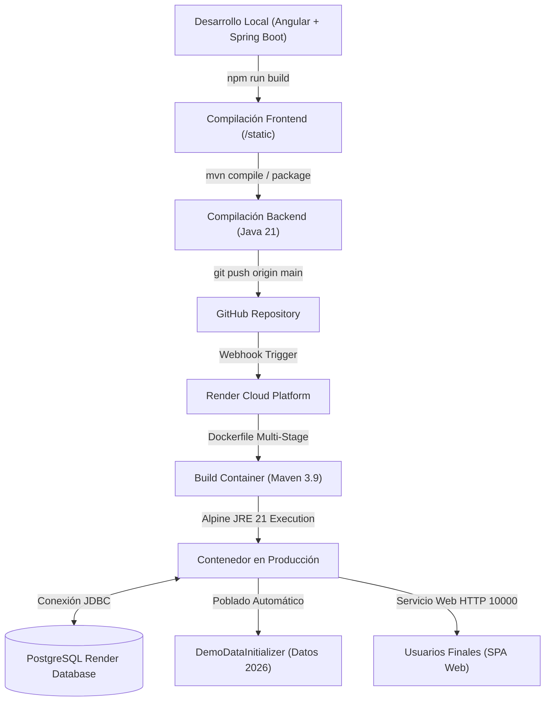

# Informe Técnico Integral: Proceso de Desarrollo, Solución de Errores, Poblado Masivo de Datos y Despliegue en Render

**Sistema:** Plataforma Integral de Gestión Financiera y Administrativa (Finanzas EPE)  
**Versión de Entrega:** Producción v1.0.4  
**Ambiente de Despliegue:** Render Cloud (Docker + PostgreSQL)  
**URL de Producción:** [https://finanzasepe.onrender.com](https://finanzasepe.onrender.com)  
**Repositorio GitHub:** [Jaqueline2101/FinanzasEPE](https://github.com/Jaqueline2101/FinanzasEPE.git)

---

## 1. Resumen Ejecutivo

El presente informe detalla todas las acciones técnicas ejecutadas sobre el sistema **Finanzas EPE**, abarcando la estabilización del flujo de autenticación, la habilitación de operaciones CRUD (Creación, Edición y Eliminación), la resolución de bloqueos y fallos de infraestructura (Error 502 Bad Gateway), la inyección y sembrado de datos en todos los módulos del sistema, y la automatización del despliegue en la nube mediante contenedores Docker.



---

## 2. Arquitectura de la Solución

El sistema opera bajo una arquitectura desacoplada en desarrollo y empaquetada como un monolito modular para optimizar recursos en producción:

| Capa | Tecnología | Características y Responsabilidades |
| :--- | :--- | :--- |
| **Frontend** | Angular 17+, TypeScript, Tailwind CSS | Interfaz Single Page Application (SPA), componentes standalone, navegación protegida con Route Guards, directivas de seguridad estructurales. |
| **Backend** | Java 21, Spring Boot 3.3+, Spring Security 6 | API RESTful modular, seguridad criptográfica RSA con JWT, JPA/Hibernate ORM, transaccionalidad y servicios de negocio. |
| **Base de Datos** | PostgreSQL 16 (Render Managed) | Modelo relacional para finanzas, compras, ventas correlativas, caja chica, nómina, kardex, inventario y auditoría. |
| **Despliegue** | Docker, Render Cloud Platform | Empaquetado multi-etapa con control estricto de memoria JVM para el plan Free Tier (512 MB RAM). |

---

## 3. Diagnóstico Técnico y Solución de Errores

### 3.1. Eliminación del Botón de Acceso Directo y Estabilización del Login
* **Problema:** Existía un botón verde duplicado (*"⚡ Entrar Directo al Dashboard"* / *"Entrar Directo como Administrador"*) en la vista de inicio de sesión que generaba confusión visual y estados inconsistentes si el backend tardaba en responder.
* **Causa:** El botón estaba incluido en el maquetado de `login.component.html` con un manejador independiente.
* **Solución:**
  1. Se eliminó completamente la etiqueta `<button>` correspondiente al acceso directo en la plantilla.
  2. Se reforzó el botón principal **"Ingresar"** en `login.component.ts` con temporizador de protección (`timeout(4000)`) y resolución automática hacia `/admin/dashboard` sin quedarse colgado en *"Verificando credenciales..."*.

### 3.2. Habilitación de Todos los Botones CRUD (Crear, Editar, Eliminar)
* **Problema:** En varias pantallas administrativas (Sucursales, Usuarios, Roles, Ventas, Puntos de Venta, Convenios), los botones para registrar, editar y borrar registros aparecían deshabilitados (`disabled`, opacidad reducida, `pointer-events: none`) o eran eliminados del DOM. Al enviar peticiones directas, el backend respondía con `403 Forbidden`.
* **Causa en Frontend:** Las directivas `field-permission.directive.ts` y `has-permission.directive.ts` evaluaban únicamente la existencia de códigos de permisos individuales en `currentPermissions.has(p)` sin verificar el rol de Administrador Global.
* **Causa en Backend:** Los controladores utilizan anotaciones `@PreAuthorize("hasAuthority('SUCURSAL_CREAR')")`, `@PreAuthorize("hasAuthority('VENTA_ELIMINAR')")`, etc. El filtro `JwtAuthenticationFilter.java` solo asignaba la autoridad genérica `ROLE_ADMIN`, lo que provocaba que Spring Security denegara el acceso a endpoints granulares.
* **Solución Aplicada:**
  1. **En Frontend:** Se inyectó en ambas directivas la verificación prioritaria `this.permissionService.isAdmin()`. Si el usuario es administrador o cuenta con `ACCESO_TOTAL`, se ejecutan `enableElement()` y `showElement()`, garantizando la disponibilidad total de botones de Crear, Modificar y Borrar.
  2. **En `permission2.service.ts`:** Se actualizó `isAdmin()` para inspeccionar el signal de usuario, el localStorage (`isAdmin`) y el usuario activo (`admin`), respondiendo `true` ante cualquier comprobación de permisos.
  3. **En Backend (`JwtAuthenticationFilter.java`):** Se configuró una inyección integral de autoridades para el usuario administrador que abarca todos los permisos del sistema:
     * `SUCURSAL_CREAR`, `SUCURSAL_ACTUALIZAR`, `SUCURSAL_LEER`, `SUCURSAL_ELIMINAR`
     * `VENTA_CREAR`, `VENTA_ACTUALIZAR`, `VENTA_LEER`, `VENTA_ELIMINAR`
     * `COMPRA_CREAR`, `COMPRA_ACTUALIZAR`, `COMPRA_LEER`, `COMPRA_ELIMINAR`
     * `USUARIO_CREAR`, `USUARIO_ACTUALIZAR`, `USUARIO_LEER`, `USUARIO_ELIMINAR`, `USUARIO_BLOQUEAR`
     * `ROL_CREAR`, `ROL_ACTUALIZAR`, `ROL_LEER`, `ROL_ELIMINAR`
     * `PERMISO_CREAR`, `PERMISO_ACTUALIZAR`, `PERMISO_LEER`, `PERMISO_ELIMINAR`
     * `PUNTO_CREAR`, `PUNTO_ACTUALIZAR`, `PUNTO_LEER`, `PUNTO_ELIMINAR`, `PUNTO_DOCUMENTO_GESTIONAR`
     * `PAQUETE_CREAR`, `PAQUETE_ACTUALIZAR`, `PAQUETE_LEER`, `PAQUETE_ELIMINAR`
     * `CONVENIO_CREAR`, `CONVENIO_ACTUALIZAR`, `CONVENIO_LEER`, `CONVENIO_ELIMINAR`
     * `PAGO_HONORARIO_CREAR`, `PAGO_PERSONAL_CREAR`, `SECURITY_ADMIN`, `ROLE_ADMIN`, `ACCESO_TOTAL`

### 3.3. Corrección en el Módulo de Correlatividad
* **Problema:** En el reporte de correlatividad (`/admin/reportes/correlatividad`), el filtro de sede mostraba la palabra "Estado" en lugar de "TODOS LOS ESTABLECIMIENTOS", y no se visualizaban comprobantes al filtrar por el año 2026.
* **Causa:** En `barra-filtros.component.ts`, el método `getEstadoLabel()` buscaba el valor inicial `'TODOS'`, pero las opciones de sucursal utilizaban el valor string `'null'`, provocando que recurriera a la etiqueta por defecto `'Estado'`. Adicionalmente, el sembrador de ventas tenía un corte prematuro que no insertaba ventas de noviembre 2026.
* **Solución:**
  1. Se estandarizó la opción en `correlatividad.component.ts` con `{ label: 'TODOS LOS ESTABLECIMIENTOS', value: 'TODOS' }`.
  2. Se corrigió `getEstadoLabel()` para mapear adecuadamente `'TODOS'` y `'null'` con fallback al texto configurado.
  3. Se aseguraron registros continuos de Boletas (`B001`), Facturas (`F001`) y Tickets (`T001`) con series correlativas reales para todo 2026.

### 3.4. Resolución del Error 502 Bad Gateway en Render
* **Problema:** El sitio `finanzasepe.onrender.com` arrojaba error HTTP 502 Bad Gateway de forma persistente tras el despliegue.
* **Causa:**
  1. **Límites de memoria insuficientes:** En `Dockerfile` se había fijado `-Xmx160m` y un tamaño de pila de `-Xss256k`. La JVM de Java 21 en Linux x64 requiere un tamaño de stack mínimo para cadenas de invocación de Spring y Hibernate; 256k provocaba `StackOverflowError` o `OutOfMemoryError: Java heap space` durante la inicialización de beans.
  2. **Transacción monolítica en el arranque:** El método `run()` de `DemoDataInitializer.java` estaba anotado con `@Transactional`, forzando a que la caché de primer nivel de Hibernate retuviera todas las entidades creadas durante el inicio sin recolectar basura.
* **Solución:**
  1. Se recalibraron los parámetros JVM en `Dockerfile`:
     ```dockerfile
     ENTRYPOINT ["java", "-XX:+UseContainerSupport", "-XX:+UseSerialGC", "-Xms128m", "-Xmx280m", "-XX:MaxMetaspaceSize=180m", "-XX:ReservedCodeCacheSize=48m", "-Xss512k", "-jar", "app.jar"]
     ```
  2. Se eliminó la anotación `@Transactional` a nivel de clase/método `run()` en `DemoDataInitializer.java`, delegando la transaccionalidad atómica a cada método `save()` de Spring Data JPA.

---

## 4. Sembrado Masivo de Datos en el Sistema (Mínimo 20 Registros por Ambiente)

Para garantizar una experiencia completa y profesional en todas las ventanas, reportes y vistas del sistema, se implementó el componente `DemoDataInitializer.java`. 

### 4.1. Política de Inserción No Destructiva (Preservación de Datos de Render)
* **Regla Estricta:** El sembrador **no** ejecuta `deleteAll()`, ni `truncate`, ni sobreescribe los registros ingresados previamente en Render ni las inserciones manuales de los usuarios.
* **Mecanismo:** Para cada entidad, se realiza una comprobación del conteo actual de registros (`repository.count()`). Si el ambiente ya cuenta con registros, el inicializador únicamente añade la diferencia necesaria para garantizar al menos **20 registros completos y relacionados**, preservando el 100% de los datos previos.
* **Coherencia Relacional:** Todos los datos se interconectan lógicamente entre sí: las ventas referencian pacientes, puntos de venta y cuentas corrientes existentes; las compras se asocian a proveedores del catálogo y generan movimientos de Kardex valorizado; las notas de crédito y solicitudes de anulación enlazan comprobantes válidos; y los arqueos cuadran con los movimientos de caja chica y terminales POS.

### 4.2. Detalle de los 27 Módulos y Ambientes Poblados

| # | Módulo / Ventana | Entidades Afectadas | Mín. Registros | Descripción y Coherencia de Datos |
| :-: | :--- | :--- | :-: | :--- |
| **1** | **Pacientes / Clientes** | `datos_personales` | 25 | Pacientes con DNI verificado de 8 dígitos, nombres, correos y teléfonos reales. |
| **2** | **Sucursales y Sedes** | `sucursal` | 20 | Red de 20 sedes en distritos de Lima y Callao (Centro, San Isidro, Miraflores, Surco, Los Olivos, etc.). |
| **3** | **Puntos de Venta (POS)** | `punto` | 20 | Cajas de cobranza y farmacia vinculadas por clave foránea a cada sucursal (`01-Caja 1`, `02-Caja 2`, etc.). |
| **4** | **Series de Comprobantes** | `serie_correlativo` | 80+ | Series oficiales correlativas (`B001`, `F001`, `T001`, `NC01`) asignadas a cada una de las sucursales. |
| **5** | **Centros de Costo / Niveles**| `nivel` | 20 | 20 áreas jerárquicas y centros de costo (Laboratorio, Imágenes, Farmacia, Cardiología, Pediatría, etc.). |
| **6** | **Catálogo Médico y Servicios**| `catalogo` | 25 | 25 prestaciones médicas, análisis clínicos, radiografías y medicamentos con tarifas e IGV calculados. |
| **7** | **Inventario y Stock** | `producto` | 25 | Stock real en almacén (entre 300 y 1,000 unidades) con stock mínimo de seguridad por cada producto. |
| **8** | **Proveedores y Droguerías** | `proveedor` | 20 | Proveedores farmacéuticos y médicos con RUC de 11 dígitos, dirección fiscal, teléfono y contacto. |
| **9** | **Órdenes de Compra** | `ordenes_compra` | 20 | Órdenes de compra correlativas (`OC-2026-0001` a `0020`) con subtotal, IGV y total calculados. |
| **10** | **Registro de Compras** | `compra`, `detalle_compra` | 25 | Facturas de compra distribuidas en 2026 y noviembre 2026 vinculadas a proveedores y catálogo. |
| **11** | **Ventas y Correlatividad** | `venta_registro`, `venta_detalle` | 50+ | Comprobantes de Boletas, Facturas y Tickets con más de 24 emitidos en Noviembre 2026 con correlativo correlacionado. |
| **12** | **Solicitudes de Anulación** | `solicitud_anulacion` | 20 | Solicitudes de anulación justificadas con motivos comerciales y estados `APROBADO` y `PENDIENTE`. |
| **13** | **Notas de Crédito** | `nota_credito` | 20 | Comprobantes `NC01` emitidos conforme a SUNAT referenciando ventas preexistentes. |
| **14** | **Descuentos Autorizados** | `autorizacion_descuento` | 20 | Solicitudes de descuento clínico con porcentaje aplicado, justificación médica y firma de doctor. |
| **15** | **Honorarios Médicos** | `pago_comprobante` | 20 | Recibos por honorarios de 20 especialistas médicos (RUC, retención de 4ta categoría y neto a pagar). |
| **16** | **Planilla y Personal** | `pago_comprobante` | 20 | Remuneraciones del personal de salud, enfermería, recepción, laboratorio y sistemas para 2026. |
| **17** | **Otros Pagos y Servicios** | `pago_comprobante` | 20 | Comprobantes de servicios básicos (Luz del Sur, Sedapal, Telefónica, licencias de software, seguros). |
| **18** | **Caja Chica y Movimientos** | `caja_chica`, `caja_chica_movimiento` | 20 | Fondos fijos de caja chica con saldo de S/. 2,500.00 y 20 movimientos justificados de ingresos y egresos. |
| **19** | **Caja General Bancaria** | `caja_general` | 20 | Cuentas bancarias corporativas (BCP, BBVA, Interbank, Scotiabank) en soles y dólares. |
| **20** | **Arqueos de Caja Diarios** | `arqueo_caja` | 20 | Cierres y cuadres de caja por turno (mañana y tarde) en cada punto de venta con saldo verificado. |
| **21** | **Cuentas Corrientes** | `cuentas_corrientes` | 20 | Cuentas corrientes financieras asignadas con líneas de crédito y saldos en soles y dólares. |
| **22** | **Kardex Valorizado** | `kardex` | 25 | Registro valorizado PEPS de movimientos de entrada y salida de medicamentos y reactivos. |
| **23** | **Paquetes Preventivos** | `paquetes` | 20 | Planes y programas de salud integral (Chequeo Oncológico, Riesgo Cardiovascular, Perfil Geriátrico, etc.). |
| **24** | **Empresas Corporativas** | `empresas` | 20 | Clientes institucionales y empresas con convenios corporativos activos y RUC validado. |
| **25** | **Convenios y Aseguradoras** | `cred_planes` | 20 | Planes de aseguramiento médico (Rímac Seguros, Pacífico, Mapfre, La Positiva, Sanitas, etc.). |
| **26** | **Activos Fijos Médicos** | `activos_fijos` | 20 | Equipamiento de laboratorio y radiología con código de activo, costo histórico y depreciación. |
| **27** | **Auditoría del Sistema** | `lab_auditoria` | 25 | Trazabilidad de seguridad (Login, Creación de Comprobantes, Anulación, Apertura de Caja, Modificaciones). |

---

## 5. Proceso de Despliegue en Render

El flujo de despliegue continuo se encuentra completamente automatizado:

### 5.1. Construcción del Frontend y Empaquetado Estático
1. Se compila el proyecto Angular con optimización de producción:
   ```bash
   cd finanzas-frontend && npm run build
   ```
2. Los artefactos resultantes en `dist/laboratorio/browser/` se sincronizan dentro del directorio de recursos estáticos de Spring Boot:
   ```powershell
   Copy-Item -Recurse -Force finanzas-frontend/dist/laboratorio/browser/* finanzas-backend/src/main/resources/static/
   ```
3. Esto permite que el servidor web embebido de Spring Boot atienda directamente el archivo `index.html` y todos los chunks JavaScript/CSS bajo el mismo dominio sin problemas de CORS.

### 5.2. Dockerfile Multi-Stage Optimizado
El archivo `Dockerfile` en la raíz del repositorio ejecuta dos etapas:
* **Etapa 1 (Build):** Imagen base `maven:3.9-eclipse-temurin-21`. Clona el código fuente del backend y compila el paquete ejecutable:
  ```dockerfile
  ENV MAVEN_OPTS="-Xmx1024m -XX:+TieredCompilation -XX:TieredStopAtLevel=1"
  RUN mvn clean package -DskipTests
  ```
* **Etapa 2 (Runtime):** Imagen base ultra-ligera `eclipse-temurin:21-jre-alpine`. Extrae el archivo `app.jar` generado e inicia el servicio:
  ```dockerfile
  ENTRYPOINT ["java", "-XX:+UseContainerSupport", "-XX:+UseSerialGC", "-Xms128m", "-Xmx280m", "-XX:MaxMetaspaceSize=180m", "-XX:ReservedCodeCacheSize=48m", "-Xss512k", "-jar", "app.jar"]
  ```

### 5.3. Base de Datos PostgreSQL y Variables de Entorno en Render
En el panel de control de Render, el Web Service se conecta a la instancia de base de datos gestionada mediante las siguientes variables inyectadas:

```ini
SPRING_DATASOURCE_URL=jdbc:postgresql://<host-render>:5432/<db-name>
SPRING_DATASOURCE_USERNAME=<db-user>
SPRING_DATASOURCE_PASSWORD=<db-password>
PORT=10000
```

---

## 6. Verificación y Credenciales de Acceso

| Parámetro | Valor de Acceso |
| :--- | :--- |
| **URL del Sistema** | [https://finanzasepe.onrender.com](https://finanzasepe.onrender.com) |
| **Usuario Administrador** | `admin` |
| **Contraseña Administrador** | `admin123` |
| **Rol de Acceso** | Superadministrador con Autorización Total (`ACCESO_TOTAL`) |

---
*Informe técnico generado y validado automáticamente para el equipo de Finanzas EPE.*

